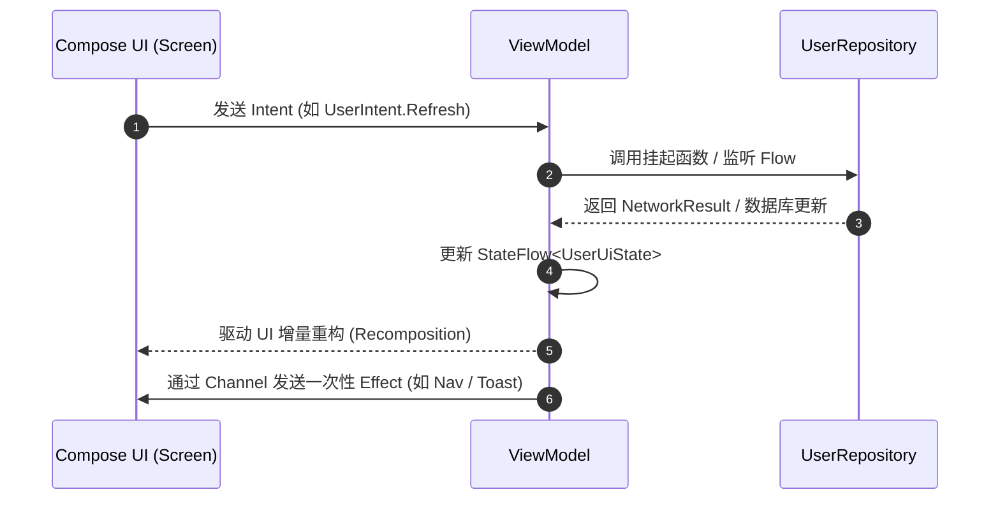
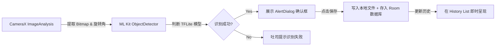

# ComposeDemo 现代 Android 架构复盘与技术文档

[](https://developer.android.com/studio)
[](https://kotlinlang.org/)
[](https://developer.android.com/studio/releases/gradle-plugin)
[](https://developer.android.com/jetpack/compose)
[](https://developer.android.com/guide/navigation)
[](https://dagger.dev/hilt/)

## 📖 项目简介

**识菜笔记 App** 是一款基于端侧 AI 的图片记录应用。用户通过相机拍摄菜品，App 利用 ML Kit 实时识别出主菜、配菜、甜点、小吃等类别，并将识别结果与图片路径持久化存储，支持历史记录的高效浏览。项目重点验证了 Jetpack Compose 声明式 UI 与端侧机器学习的高效结合方案。

**ComposeDemo** 是一个严格遵循 **Modern Android Development (MAD)** 规范的高标准、多模块 (Multi-Module) Android 示例项目。项目集成了 **Jetpack Compose**、**Navigation 3 声明式导航**、**MVI 单向数据流 (UDF)**、**Proto DataStore**、**Room + Retrofit 离线优先架构**，以及 **CameraX + Google ML Kit 视觉智能识别**。

本文档是对该项目整体架构设计、技术选型、模块化拆分、数据流向以及性能优化的完整复盘。

---

## 🏗️ 整体架构图

项目整体采用 **Clean Architecture** 思想分层，并通过 Gradle 复合构建 (`build-logic`) 进行工程化解耦。各模块职责清晰，依赖关系单向向下传递。

```mermaid
graph TD
    subgraph App Host Layer [宿主层]
        APP[":app (Navigation 3, Adaptive UI, App Entry)"]
    end

    subgraph Feature Layer [业务功能层 (MVI范式)]
        FEAT_RECOG[":feature:recognition (CameraX + ML Kit)"]
        FEAT_USER[":feature:user (History List)"]
        FEAT_DETAIL[":feature:userDetail (AssistedInject Detail)"]
    end

    subgraph Data Layer [数据仓储层 (Repository Pattern)]
        DATA_USER[":data:user (UserRepo, RemoteMediator)"]
        DATA_PREF[":data:preferences (Proto DataStore, AB Test)"]
    end

    subgraph Core Infrastructure Layer [核心基础层]
        CORE_MODEL[":core:model (Domain Models)"]
        CORE_NET[":core:network (Retrofit, OkHttp APM, CallAdapter)"]
        CORE_DB[":core:database (Room Database, UserDao)"]
        CORE_COMMON[":core:common (AppLogger, Analytics, NetworkMonitor)"]
    end

    subgraph Build Logic [复合构建逻辑]
        BUILD_LOGIC[":build-logic:convention (Convention Plugins)"]
    end

    %% Dependencies
    APP --> FEAT_RECOG
    APP --> FEAT_USER
    APP --> FEAT_DETAIL
    APP --> DATA_USER
    APP --> DATA_PREF
    APP --> CORE_COMMON

    FEAT_RECOG --> DATA_USER
    FEAT_RECOG --> CORE_MODEL
    FEAT_RECOG --> CORE_COMMON

    FEAT_USER --> DATA_USER
    FEAT_USER --> CORE_MODEL
    FEAT_USER --> CORE_COMMON

    FEAT_DETAIL --> DATA_USER
    FEAT_DETAIL --> CORE_MODEL
    FEAT_DETAIL --> CORE_COMMON

    DATA_USER --> CORE_DB
    DATA_USER --> CORE_NET
    DATA_USER --> CORE_MODEL
    DATA_USER --> CORE_COMMON

    DATA_PREF --> CORE_MODEL
    DATA_PREF --> CORE_COMMON
```

---

## 🧩 模块化与工程化设计

项目采用了标准的 Modern Android 模块划分策略，共包含 12 个 Gradle 子项目：

| 模块类别 | 模块路径 | 职责描述 |
| :--- | :--- | :--- |
| **App 宿主** | `:app` | 全局入口、Hilt 依赖注入总装、`Navigation 3` 自适应路由配置、Material3 皮肤主题 |
| **业务功能** | `:feature:user` | 用户识别历史列表界面 (MVI + Immutable Collections) |
| **业务功能** | `:feature:userDetail` | 物品/用户详情界面 (MVI + AssistedInject ViewModel) |
| **业务功能** | `:feature:recognition` | 拍照实时识别界面 (CameraX + Camera Compose + ML Kit 算法) |
| **数据仓储** | `:data:user` | 用户/识别记录数据源 (Room + Retrofit + Jetpack Paging 3 离线优先) |
| **数据仓储** | `:data:preferences` | 本地轻量配置仓储 (Proto DataStore + Protobuf 序列化 + AB 实验管理) |
| **核心基础设施**| `:core:common` | 跨模块通用工具、AppLogger 统一日志、APM 埋点、App Startup、NetworkMonitor |
| **核心基础设施**| `:core:network` | Retrofit 3 客户端、OkHttp APM 耗时监控、自定义 `NetworkResultCallAdapter` |
| **核心基础设施**| `:core:database` | Room 2.8 数据库定义、实体 (`UserEntity`) 及 Dao 接口 |
| **核心基础设施**| `:core:model` | 跨模块无依赖纯 Kotlin 领域模型 (`User`, `AbTestExperiment`) |
| **工程构建** | `:build-logic` | Gradle 复合构建插件定义，统一管理 Gradle Plugin 与编译选项 |
| **性能测试** | `:benchmark` | Macrobenchmark Baseline Profiles 自动生成与基准测试 |

### 1. Gradle 复合构建 (`build-logic/convention`)
为了避免在各个子模块的 `build.gradle.kts` 中重复书写构建配置，项目引入了 Gradle `includeBuild("build-logic")` 机制，编写自定义 Convention Plugins：
- **`AndroidApplicationConventionPlugin`**: 统一配置 Android App 模块的基础属性、Java/Kotlin 17 编译选项、Kotlin 编译器参数、Detekt/Ktlint 及 Flavors。
- **`AndroidLibraryConventionPlugin`**: 统一配置 Android Library 模块，提供 Release 混淆规则预制。
- **`AndroidFeatureConventionPlugin`**: 自动为业务 Feature 模块应用 Compose 编译器插件与 Hilt 依赖注入，免除繁琐的手工引入。
- **`Flavors.kt`**: 自动化生成 `dev`, `staging`, `prod` 三大环境的 Product Flavors 与 `BASE_URL` 动态 `BuildConfig` 字段。

---

## 🏛️ 核心分层与技术复盘

### 1. MVI (Model-View-Intent) 响应式架构
业务 Feature 模块（如 `:feature:user`, `:feature:userDetail`, `:feature:recognition`）全面采用 **MVI 单向数据流 (UDF)** 范式，确保 UI 状态强可预测、易调试与高测试覆盖率。



- **UiState**: 采用 `@Immutable` 标记的数据类完整描述界面状态。使用了 `kotlinx.collections.immutable` 的 `ImmutableList` 提升 Compose 重构稳定性。
- **Intent**: 密封接口 (`sealed interface`) 声明用户在界面上的所有交互动作。
- **Effect**: 使用带缓冲的 `Channel` 传递一次性事件（如显示 Toast、导航跳转），防止屏幕旋转时重复消费。

### 2. Navigation 3 与自适应布局 (Adaptive Navigation)
- 项目采用了最新的 **Jetpack Navigation 3 (`androidx.navigation3`)** 框架。
- 路由 Key 使用 Kotlin `@Serializable` 装饰（如 `data object UserList : NavKey`, `data class UserDetail(val userId: String) : NavKey`），实现编译期绝对类型安全。
- 结合 `NavigationSuiteScaffold` 与 `currentWindowAdaptiveInfo()`，能在手机、折叠屏、平板及桌面设备间无缝切换底部导航栏 (`NavigationBar`) 与侧边导航轨 (`NavigationRail`)。

### 3. 实时智能识别流水线 (`:feature:recognition`)
- **取景器与相机绑定**: 采用 `androidx.camera.compose` 的 `CameraXViewfinder` 和 `ImageAnalysis` 组合。
- **ML Kit 视觉推断**: 支持优雅降级策略 —— 优先加载 `assets/food.tflite` 自定义物体检测模型；若未配置则自动切换至通用 ML Kit 物体分类检测器。
- **图像矩阵转置与持久化**: 处理 Camera 硬件帧旋转角度 (`rotationDegrees`)，生成高保真 Bitmap 并通过协程 IO 写入本地存储，离线保存至 Room 数据库。



### 4. 离线优先 (Offline-First) 仓储与网络层
- **自定义 Retrofit CallAdapter Factory**: 设计了 `NetworkResultCallAdapterFactory`，将网络响应统一封装为泛型 `NetworkResult<T>` (`Success`, `Error`, `Exception`)，消灭了散落在各处的 `try-catch` 逻辑。
- **APM 网络指标监控**: 实现了 OkHttp `EventListener` (`MetricsOkHttpEventListener`)，精准追踪每个 HTTP 请求的 DNS 解析耗时、TCP 建连耗时及总网络延迟，并在控制台/日志中输出耗时打点。
- **Jetpack Paging 3 + RemoteMediator**: 在 `:data:user` 中实现 `UserRemoteMediator`，协调 Room `UserDao` 缓存与远端 API 接口，实现优雅的分页加载与无网断连优雅降级。
- **Proto DataStore**: 在 `:data:preferences` 中摒弃了传统的 SharedPreferences，采用 Protobuf 强类型定义 `UserPreferences` 方案，保障高性能、异步主线程安全的数据读写。

### 5. 跨模块通用设施 (`:core:common`)
- **声明式埋点分析 (`AnalyticsHelper`)**: 提供 `LocalAnalyticsHelper` CompositionLocal，支持通过 Compose Modifier 扩展 `.trackClick("event_name", params)` 实现无侵入的点击埋点上报。
- **统一日志治理 (`AppLogger`)**: 封装对 `android.util.Log` 的直接依赖，自动在 Release 环境下屏蔽调试级别日志，并提供集中式 APM/Crash 上报入口。
- **App Startup (`LoggerInitializer`)**: 借助 Jetpack Startup 实现基础组件在 App 启动时的零侵入延迟初始化。
- **网络状态监控 (`ConnectivityManagerNetworkMonitor`)**: 基于 Android System `ConnectivityManager.NetworkCallback` 提供实时的 `Flow<Boolean>` 联网状态监听。

---

## 🛠️ 技术栈与依赖库一览

| 维度 | 技术/库名称 | 版本/说明 |
| :--- | :--- | :--- |
| **语言与核心** | Kotlin | `2.4.0` (开启 Coroutines/Flow 实验性 API) |
| **构建工具** | AGP + KSP | AGP `9.6.0-alpha02`, KSP `2.3.9` |
| **UI 框架** | Jetpack Compose | Compose BOM `2026.02.01`, Material 3 `1.12.1` |
| **导航路由** | Navigation 3 | `androidx.navigation3:1.0.0-alpha06` |
| **自适应布局** | Adaptive Navigation Suite | `androidx.compose.material3:material3-adaptive-navigation-suite` |
| **依赖注入** | Hilt | `2.60.1` (包含 Hilt Compose & AssistedInject) |
| **网络层** | Retrofit + OkHttp | Retrofit `3.0.0`, OkHttp `5.4.0` |
| **序列化** | kotlinx.serialization | `1.11.0` (JSON 运行时) |
| **本地数据库** | Room | `2.8.5` (包含 Room KTX & Room Paging) |
| **键值存储** | Proto DataStore | `1.2.1` + Google Protobuf Lite `4.31.0` |
| **相机与 AI 识别**| CameraX + Google ML Kit | CameraX `1.6.2`, ML Kit Object Detection `17.0.2` |
| **图片加载** | Coil 3 | `io.coil-kt.coil3:coil-compose:3.0.4` |
| **不可变集合** | kotlinx-collections-immutable | `0.5.2` (提升 Compose 重绘性能) |
| **代码规范** | Detekt + Ktlint | Detekt `1.23.8`, Ktlint `14.2.0` |
| **性能与诊断** | LeakCanary + Macrobenchmark | LeakCanary `2.14`, Macrobenchmark `1.3.3` |

---

## 📈 代码质量治理与性能优化策略

1. **Compose 重写性能优化**:
   - 领域数据模型 (`User`, `AbTestExperiment`) 均使用 `@Immutable` 装饰。
   - 集合列表类型统一使用 `ImmutableList` / `persistentListOf`，防止非必重绘。
   - 列表 `LazyColumn` key 使用持久唯的一 ID (`user.id`) 进行 Diffing 优化。
2. **内存泄露防护**:
   - 在 `debugImplementation` 中集成了 `LeakCanary`，自动检测并提醒 Activity/Fragment/ViewModel 泄露。
3. **自动化基准测试与 Baseline Profiles**:
   - 子项目 `:benchmark` 配置了 `BaselineProfileGenerator`，可自动生成应用启动与关键用户旅程 (CUJ) 的热点代码预编译文件，优化应用冷启动速度。
4. **代码静态检查机制**:
   - 在根目录提供 Detekt (`config/detekt/detekt.yml`) 配置与 Ktlint 规则，统一团队代码风格。

---

## 🚀 构建与运行指南

### 环境要求
- **Android Studio**: Ladybug (2024.2.1) 或更高版本
- **JDK**: Java 17 (推荐使用 Android Studio 内置 JBR)
- **Android SDK**: `compileSdk = 37`, `minSdk = 29`

### 构建步骤
1. 克隆/打开项目：
   ```bash
   git clone <repository-url>
   ```
2. 执行 Gradle 规则检查与编译：
   ```bash
   # 运行静态代码检查
   ./gradlew detekt

   # 编译 Debug APK (dev Flavor)
   ./gradlew :app:assembleDevDebug
   ```
3. 单元测试运行：
   ```bash
   ./gradlew test
   ```

---

## 🎯 总结与展望

ComposeDemo 项目展现了 **Modern Android Development** 范式下的工程化最高标准。通过将应用拆分为粒度合理的模块，配合统一的 `build-logic` 约定插件，大大降低了业务逻辑耦合度与后期维护成本。结合 Jetpack Navigation 3 与 Compose MVI 架构，项目不仅在性能、可测试性上达到了极佳标准，也为复杂商业 Android 应用开发提供了坚实的架构范本。
